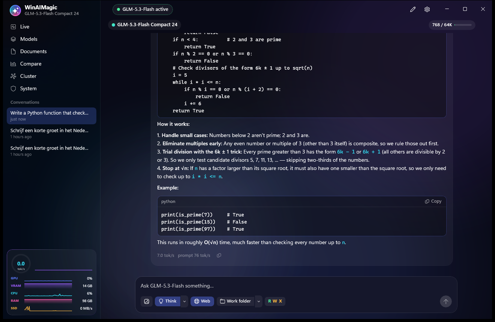
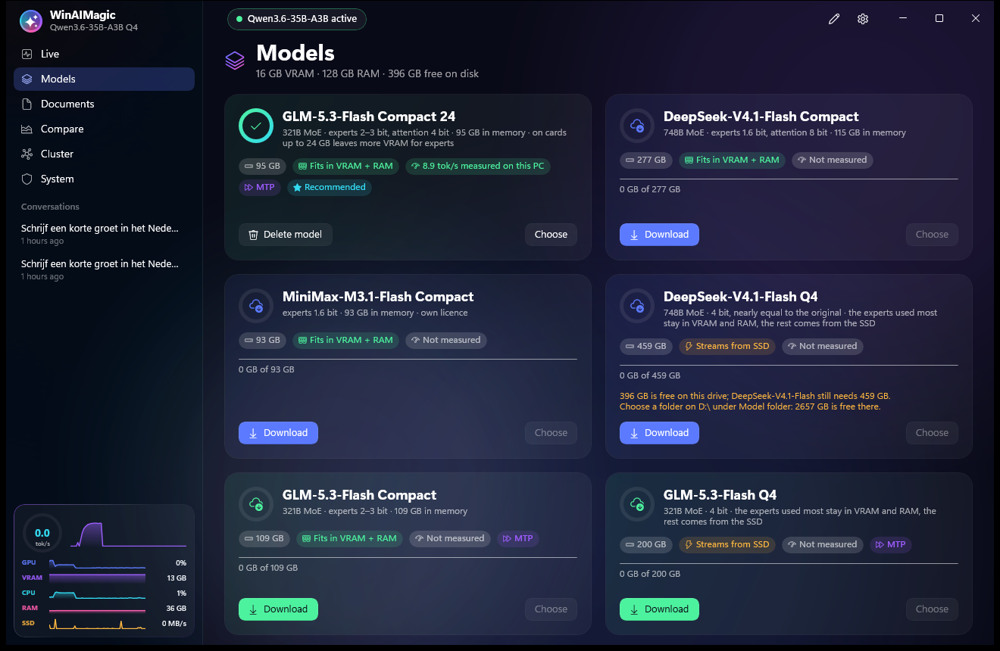
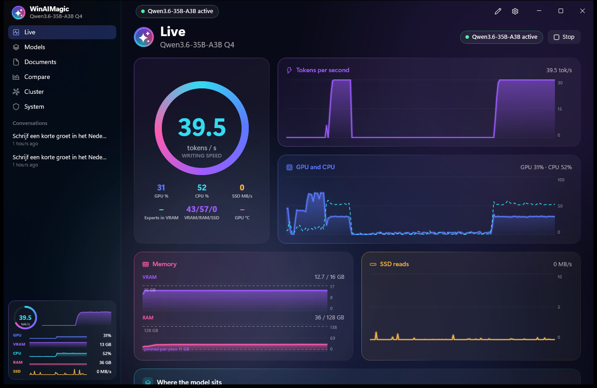
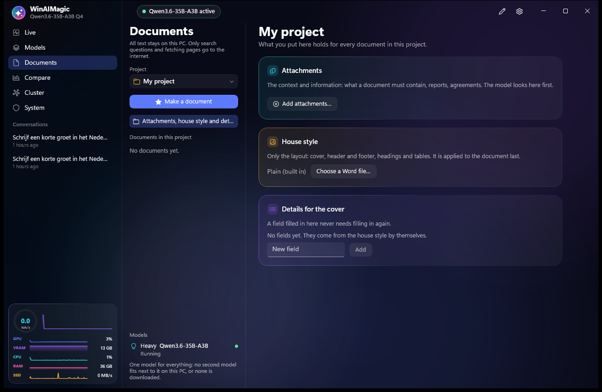
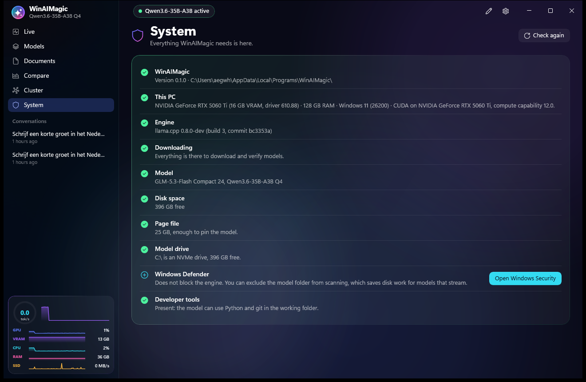

<p align="center">
  
</p>

<h1 align="center">WinAIMagic</h1>

<p align="center">
  <strong>Run huge AI models entirely on your own Windows 11 PC.</strong><br>
  Models that do not fit in your video card simply stream from RAM and SSD. Nothing leaves your computer.
</p>

<p align="center">
  <a href="https://github.com/mfidder2026/WinAIMagic/releases/latest">Download the installer</a> ·
  <a href="docs/README.nl.md">Nederlands</a>
</p>



WinAIMagic is the Windows version of [MacAIMagic](https://github.com/mfidder2026/MacAIMagic). Install it with one setup file: no Python, no Visual Studio and no CUDA Toolkit needed, just a video card driver.

## What it does

- **Chat** with thinking limits, images, web search, and a context meter that summarizes before the model runs out of room. Images have been run on GLM and Qwen3.6; DeepSeek and MiniMax are wired but not yet run with a real image, and each model fetches its image files separately (about 1 to 1.7 GB).
- **Work in a folder.** The model reads and writes files and runs commands there, with your approval per kind of action (read, write, run). It keeps going until the job is done and remembers what it learned.
- **Documents.** Turn notes and attachments into a Word file in your own house style, section by section, with sources. You review the draft before the `.docx` is written.
- **Images.** Make images from a description, on your own PC.
- **Compare** models with the same measurement on your own PC, and export the results.
- **A local API** on `http://127.0.0.1:8080`: OpenAI (`/v1`), Anthropic (`/v1/messages`) and Responses (`/v1/responses`), so other tools can use your model.
- **Choose where models live**, on any drive, and move them later without downloading again.
- **Cluster** several PCs over USB4, Thunderbolt or ethernet for models on the second engine.

Available in English, Dutch, German and French.

## Screens

| Models | Live dashboard |
|---|---|
|  |  |
| **Documents** | **System check** |
|  |  |

## Install

1. Download `WinAIMagic-Setup-*.exe` from [Releases](https://github.com/mfidder2026/WinAIMagic/releases/latest) (about 2.1 GB).
2. Run it. Choose a folder for the models, ideally on a fast NVMe drive. No administrator rights are needed.
3. Windows SmartScreen may warn you, because this installer is not code-signed yet: choose **More info** and **Run anyway**. The `.sha256` next to the installer lets you check the file.
4. In the app, open **Models**, download a model, and press **Start engine**.

The system check tells you what your PC still needs. The most common one: the Windows page file must be at least your VRAM plus 9 GB. The app offers a button for that; it asks for permission and needs a restart.

## How large models fit

A Mac has one memory pool. A PC has three layers: VRAM, RAM and SSD. WinAIMagic plans over all three and starts the model anyway when it does not fit: the experts used most stay in VRAM and RAM, and the rest stream from the SSD. A model is never called "too big".

Two engines do the work. The main engine handles large mixture-of-experts models across the three layers. The second engine, based on llama.cpp, runs smaller models, the cluster, and PCs without a supported card.

| Video card | Main engine | Second engine |
|---|---|---|
| NVIDIA RTX 20 series and newer | Yes | CUDA |
| AMD | Not in this version | Vulkan |
| Intel Arc and others | No | Vulkan |
| No usable card | No | CPU |

## Measured speed

Measured with the app's own method: a 4,000-token prompt read, then 300 tokens written, 64K context.
**PC: RTX 5060 Ti 16 GB on PCIe 3.0 x8, Core i9-10900K, 128 GB DDR4-2400 in two channels, NVMe. Windows 11.**

| Model | Load | Prompt reading | Writing | VRAM | RAM |
|---|---|---|---|---|---|
| Qwen3.6-35B-A3B Q4 (second engine) | 15 s | 380 tok/s | **39.5 tok/s** | 13.6 GB | 38 GB |
| GLM-5.3-Flash Compact 24 (main engine) | 98 s | 354 tok/s | **8.9 tok/s** | 14 GB | 98 GB |
| Ministral-3-8B Q4 (second engine) | 4 s | 3,260 tok/s | **68.0 tok/s** | 13.3 GB | 29 GB |

| Image model | One image of 1024 x 1024, with loading | Image tokens | VRAM |
|---|---|---|---|
| FLUX.2 Klein 4B | **9.1 s** | 5,366 per second | 7.8 GB |

The owner measured all four again with 0.2.6 on 5 November ([raw data](docs/measurements/2026-11-05-app-0.2.6.json)). GLM wrote 8.5 tok/s that time. Qwen3.6 wrote 31.4 tok/s, with the experts of 28 layers on the processor instead of 23; why the plan gave it fewer layers on the card that time has not been looked into.

GLM can write faster on a card short of VRAM: **Skip experts**, a choice beside the Start button on the Models page, reaches 11.3 (light) or 12.2 tok/s (strong) on this PC, but the answers then differ a little from the full model. It is off by default, and Compare shows each choice as its own row.

Your numbers depend mostly on your CPU, your memory channels and your video card's link, so measure on your own PC under **Compare**. The other models in the catalog show "not measured" until you do. This is one PC with one video card; AMD has not been measured at all.

### A laptop with little memory

Ministral-3-8B Q4 is the model for a PC with 8 or 16 GB of RAM. Measured on the same PC with limits that stand in for a laptop, not on a real one. Writing speed on a real laptop's processor will differ.

| Stands in for | Context | Writing |
|---|---|---|
| A 16 GB card | 8K to 32K | **72 tok/s** |
| An 8 GB card: 28 of its 34 layers on the card | 8K | **20 tok/s** |
| No card, 16 GB of RAM: 4 processor threads | 16K in the app | **5 tok/s** |

On 8 GB of RAM without a card the model needs about 5 GB free. With a limit of 5 GB on what it may keep in memory it still writes 5 tok/s; with 4.5 GB it drops to 0.7 tok/s, also at a smaller context, and a real SSD would make that worse. So close other programs there.

**The 8-bit cache.** With a video card the second engine keeps what it remembers of the conversation (the KV cache) in 8 bits instead of 16. Measured with Ministral on this PC:

- At 32K context it uses 8.6 GB of VRAM instead of 10.6; at 8K, 6.8 instead of 7.3.
- On an 8 GB card that room holds 28 layers instead of 24, which writes 20.0 instead of 14.0 tok/s and reads prompts at 1,663 instead of 1,296 tok/s.
- With the whole model on the card it costs a little speed: 72.5 instead of 74.7 tok/s, and prompts 1-2% slower.
- The answers stay the same: on a text of 28,000 tokens the model chose the same next token in 98.8% of the places.

Without a card it stays at 16 bits. With 4 processor threads, 8 bits read a prompt after 4,000 tokens at 8 instead of 23 tok/s. For Qwen3.6 it saves only 0.3 GB at 32K, because that model has little cache. The tables above were measured with the 16-bit cache.

**Send us your numbers.** Laptops are what we cannot measure ourselves. After a measurement under **Compare**, **Share on GitHub** opens [a form](https://github.com/mfidder2026/WinAIMagic/issues/new?template=meting.yml) where you drop the exported file. Nothing is sent until you send it there.

### Making images

FLUX.2 Klein 4B makes images on the **Images** page. It downloads 5.3 GB (the image model, a text model and a decoder). Measured on the same PC at 4 steps, with limits that stand in for a smaller PC:

| Stands in for | Image | Time | Memory |
|---|---|---|---|
| A 16 GB card | 1024 x 1024 | **8 s** | 8.1 GB on the card |
| An 8 GB card | 1024 x 1024 | **9 s** | 3.9 GB on the card |
| No card, 4 processor threads | 512 x 512 | **2.5 min** | 2.2 GB of its own |
| No card, 4 processor threads | 768 x 768 | **5 min** | 4.4 GB of its own |
| No card, 4 processor threads | 1024 x 1024 | **9 min** | 7.5 GB of its own |
| No card, 4 threads, last step in parts | 1024 x 1024 | **12 min** | 1.4 GB of its own |

FLUX also stands on the Models page (**Kies voor afbeeldingen**) and in **Compare**, which makes the same image of 1024 x 1024 on every PC: 10 s with loading on the test PC, about 5,000 image tokens per second. While it draws, the speed gauge counts those image tokens. The model follows an English description best. **Improve with the web** lets the fast model (Snel) write that English description first, and look up on the web what something looks like; only the search and the pages it reads go out. The page lists every step with the model that does it, and the pill at the top names every model in memory.

Every model card has the same role buttons: **Zwaar** (the chat model), **Snel** (the documents module's fast model) and **Afbeeldingen**. Documents shows all three with a green dot while they run.

Beside what it holds of its own, the engine reads the model files from disk; 512 x 512 took the same time when it might keep only 2.5 GB in memory. A real laptop's processor and SSD will differ. The app picks a size and the way of working that suit the PC, and the chat engine stops while an image is made: there is rarely room for both.

## Models

| Model | Download | Licence |
|---|---|---|
| Ministral-3-8B Q4 | 5 GB | Apache 2.0 |
| FLUX.2 Klein 4B (images) | 5 GB | Apache 2.0 |
| Qwen3.6-35B-A3B Q4 | 22 GB | Qwen community licence, shown before download |
| GLM-5.3-Flash Compact 24 | 95 GB | MIT |
| MiniMax-M3.1-Flash Compact | 93 GB | MiniMax community licence, shown before download |
| GLM-5.3-Flash Compact | 109 GB | MIT |
| Qwen3.8-Flash-Next Q4 | 111 GB | Qwen community licence, shown before download |
| GLM-5.3-Flash Q4 | 200 GB | MIT |
| DeepSeek-V4.1-Flash Compact | 277 GB | MIT |
| DeepSeek-V4.1-Flash Q4 | 459 GB | MIT |

Read the model licences before using a model commercially. Only Ministral, Qwen3.6 and GLM-5.3-Flash Compact 24 have been run on the test PC so far.

## Privacy

Only web search and model downloads go out, and web search can be turned off. There is no telemetry and no update check.

## Build from source

You need Visual Studio 2022 Build Tools with C++, the CUDA Toolkit, CMake, Ninja, the Vulkan SDK, the .NET 10 SDK, Python 3 and Inno Setup.

```bash
sh scripts/fetch-llama-tiered.sh
sh scripts/fetch-llama-engine.sh
scripts\build-tiered-cuda.bat "75;80;86;89;120"
scripts\build-vision-cuda.bat "75;80;86;89;120"
scripts\build-llama.bat cuda
scripts\build-llama.bat vulkan
scripts\build-llama.bat cpu
python scripts/package.py
```

Tests: `dotnet test tests/WinAIMagic.Chat.Tests -c Debug -p:Platform=x64`, and likewise for `Engine`, `Documents` and `Studio`.

See [docs/PARITY.md](docs/PARITY.md) for how this version relates to MacAIMagic and what is still open, and [docs/RESEARCH.md](docs/RESEARCH.md) for the measurements.

## Licence

MIT, see [LICENSE](LICENSE). Included third-party software is listed in `THIRD_PARTY_NOTICES.md`, which is also in the installation folder.
